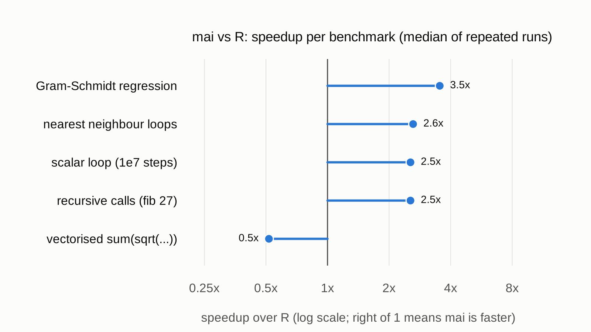

# mai documentation

mai is a compiled language for statistical computing, from Brendan McArdle's
2018 PhD thesis at the University of Auckland,
[*A Compiled Language for Statistical Computing*](https://researchspace.auckland.ac.nz/items/9dd448b6-5736-40f8-b9c8-e2aedff3d385).
It reads like R but compiles to bytecode for a fast virtual machine.

| Page | What's in it |
| --- | --- |
| [Getting started](getting-started.md) | Build, run a script, use the REPL, split code across files |
| [Language guide](language-guide.md) | Values, types, declarations, functions, control flow, vectors and arrays |
| [Differences from R](differences-from-r.md) | What an R user trips over first, in one table |
| [Built-in functions](builtins.md) | Every built-in, grouped by purpose |
| [Worked examples](examples.md) | Eight short, tested scripts, from the basics to regression |
| [Performance](performance.md) | Benchmarks against R, and how to reproduce them |
| [Embedding](embedding.md) | Run mai from C, R or Python through `libmai` and `mai.h` |
| [pymai](../python/README.md) | The Python package and `%%mai` Jupyter magic |
| [rmai](https://mai-lib.github.io/rmai/) | The R package: pass R data to mai, and `{mai}` chunks in R Markdown and Quarto |
| [Internals](internals.md) | How the compiler and VM fit together, and where each part lives in the thesis |

Each worked example in [`../examples`](../examples) has a matching `.out`
file holding its exact output, and `make check` runs them all, so the
examples are tested along with everything else.

