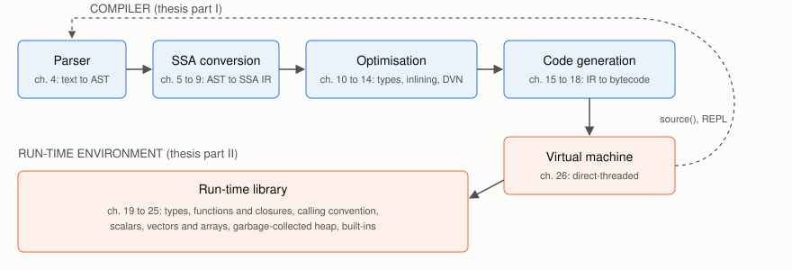

# Internals



Every top-level expression, included file and `source()`d file is compiled
before it runs:

1. **Parse** (thesis ch. 4): a Bison grammar (`src/grammar.y`) and a
   hand-written lexer (`src/lexer.c`) build an abstract syntax tree.
2. **SSA conversion** (ch. 5 to 9): the tree becomes a graph of basic
   blocks, and the compiler resolves scopes, builds the dominator tree and
   puts the graph into static single assignment form.
3. **Optimisation** (ch. 10 to 14): sparse conditional constant propagation
   recovers types and constants. Small `const` functions are inlined, and
   variables captured by closures are moved into heap cells. Redundant
   computations are then removed by dominator-based value numbering.
4. **Code generation** (ch. 15 to 18): live-range analysis and linear-scan
   allocation assign frame locations, SSA form is destroyed, and bytecode is
   emitted.
5. **Execution** (ch. 26): a directly threaded virtual machine runs the
   bytecode. It has specialised instructions for unboxed `int` and `double`
   scalars, and calls into the run-time library (ch. 19 to 25) for objects,
   types, calls, vectors and garbage collection.

## Seeing it work

Set `dbg_dump_ir` and compile something afterwards (here, via `source()`)
to print the optimised IR and the bytecode of each function:

```
# sq.mai
const sq = function(double x) : double x * x
print(sq(3.0))
```

```
options(dbg_dump_ir = true)
source("sq.mai")()
```

The body of `sq` comes out as:

```
function 0.0 sq.mai : function (double x) : double
block 0. (0 - 3)
0.0: BIND (argbits) (nil) : int
0.1: BIND x (nil) : double
0.2: BUILTIN `*`@double (1, 1) : double
0.3: RETURN 2

0000  mul.d   0  -40 -40
000e  ret     0
```

Because `x` is declared `double`, the generic `*` became a single unboxed
`mul.d` instruction. Turning the passes off one at a time (for example
`options(opt_inline = false)`) is a good way to see what each contributes.

## Where the code lives

The `.nw` files are the thesis chapters, each holding prose and code
together. `src/` is the code extracted from them.

| Thesis chapter | Literate source | Extracted code |
| --- | --- | --- |
| 1 Introduction | `intro.nw` | the examples `src/*.src`, `src/*.R`, `src/*.py` |
| 2 Executable | `main.nw` | `src/main.c` |
| 3 Compiler | `compiler.nw` | `src/compiler.c` |
| 4 Parser | `parser.nw` | `src/lexer.c`, `src/grammar.y`, `src/parser.c` |
| 5 Intermediate Representation | `ir.nw` | `src/ir.c`, `src/ir.h` |
| 6 AST Conversion | `ir_convert.nw` | `src/ir_convert.c` |
| 7 IR Preparation | `ir_pre.nw` | `src/ir_pre.c`, `src/ir_closure.c` |
| 8 Dominator Tree | `ir_dom.nw` | `src/ir_dom.c` |
| 9 SSA Form Construction | `ir_ssa.nw` | `src/ir_ssa.c` |
| 10 Analysis and Optimisation | `opt.nw` | `src/opt_sccp.c`, `src/opt_trans.c` |
| 11 Inline Expansion | `opt_inline.nw` | `src/opt_inline.c` |
| 12 Cell Introduction | `opt_closure.nw` | `src/opt_closure.c` |
| 13 Postpass | `opt_post.nw` | `src/opt_post.c`, `src/opt_call.c` |
| 14 Value Numbering | `opt_dvn.nw` | `src/opt_dvn.c` |
| 15 Code Generation | `gen_code.nw` | `src/gen_code.c` |
| 16 Live Range Analysis | `gen_range.nw` | `src/gen_range.c` |
| 17 Location Allocation | `gen_loc.nw` | `src/gen_loc.c` |
| 18 SSA Form Destruction | `gen_unssa.nw` | `src/gen_unssa.c` |
| 19 Runtime | `runtime.nw` | `src/rt/runtime.c` |
| 20 Types | `type.nw` | `src/rt/type.c` |
| 21 Functions, Closures, Builtins | `callable.nw` | `src/rt/callable.c` |
| 22 Calling Convention | `call.nw` | `src/rt/call.c` |
| 23 Scalars | `scalar.nw` | `src/rt/scalar.c` |
| 24 Vectors and Arrays | `vector.nw` | `src/rt/vector.c` |
| 25 Memory Management | `gc.nw` | `src/rt/gc.c` |
| 26 Virtual Machine | `vm.nw` | `src/vm/` |
| Embedding (new) | `embed.nw` | `src/embed.c`, `src/mai.h` |
| Appendices | `rt.nw`, `arith.nw`, `hash.nw`, `util.nw`, `debug.nw` | built-ins, options, maths library and RNG in `src/rt/`; M4-generated arithmetic kernels in `src/arith/`; hash tables and utilities |

## Changing the code

Edits to `src/` are lost if `src/` is ever regenerated from the `.nw`
files. The project hasn't yet chosen whether `src/` or the `.nw` files are
the source of truth for new work. Until it does, make small fixes in `src/`
and mention them in the commit message.
